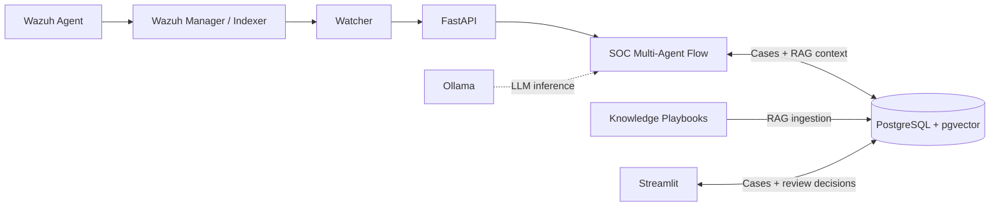

# SOC Multi-Agent

A lab-oriented Security Operations Center (SOC) prototype that analyzes Wazuh alerts using four AI agents: **Triage**, **Enrichment**, **Investigation**, and **Remediation**. CrewAI Flow coordinates the workflow, PostgreSQL stores case state, and Streamlit provides an analyst dashboard.

## Architecture



The workflow follows **Triage → Enrichment → Investigation → Remediation**, with conditional routing to Monitoring when further analysis is unnecessary. RAG retrieves playbook context before Investigation and is optional if retrieval fails. Streamlit reads cases directly from PostgreSQL; human review records approval or rejection without executing endpoint remediation.

## Requirements

- Python 3.13+ and [uv](https://docs.astral.sh/uv/)
- PostgreSQL with the [pgvector](https://github.com/pgvector/pgvector) extension
- [Ollama](https://ollama.com/) for local LLMs and RAG embeddings
- [Wazuh Indexer](https://documentation.wazuh.com/current/) for live alert ingestion

An existing PostgreSQL database/user and a configured Wazuh environment are assumed. Gemini and VirusTotal are optional integrations.

For the VMware networking and Wazuh Agent configuration used in the lab, see [Lab setup](docs/lab-setup.md).

## Setup

```bash
git clone https://github.com/khanhduy156ka/TTCS.git
cd TTCS
uv sync
cp .env.example .env
```

On Windows PowerShell, use `Copy-Item .env.example .env` instead of `cp`. Edit `.env` with your PostgreSQL, Wazuh Indexer, and model settings. The Wazuh connection variables and PostgreSQL password are required by the application settings, even when running without live ingestion. Never commit credentials.

Prepare the local Ollama models and the MITRE ATT&CK dataset:

```bash
ollama pull qwen3.5:9b
ollama pull qwen3-embedding:0.6b
uv run python scripts/download_mitre.py
```

In the target PostgreSQL database, enable pgvector (with a role authorized to install extensions):

```sql
CREATE EXTENSION IF NOT EXISTS vector;
```

Create the application tables and index the included playbooks:

```bash
psql -h localhost -U soc_app -d soc_multi_agent -f sql/schema.sql
uv run python -m soc_multi_agent.rag.init_db
uv run python -m soc_multi_agent.rag.ingest --knowledge-dir knowledge
```

The database connection above assumes the default values in `.env.example`; adjust it to your environment. RAG uses `qwen3-embedding:0.6b` with 1024-dimensional vectors.

## Run

Start each component in a separate terminal.

**API**

```bash
uv run uvicorn soc_multi_agent.api.app:app --host 127.0.0.1 --port 8000
```

**Analyst dashboard**

```bash
uv run streamlit run src/soc_multi_agent/ui/streamlit_app.py
```

**Wazuh watcher** (for live alerts)

```bash
uv run python -m soc_multi_agent.wazuh_ingestion --watch --size 100 --min-level 5 --interval 15
```

- API documentation: [http://127.0.0.1:8000/docs](http://127.0.0.1:8000/docs)
- API/database health: [http://127.0.0.1:8000/health](http://127.0.0.1:8000/health)
- Dashboard: [http://localhost:8501](http://localhost:8501) (default Streamlit port)

The health endpoint checks **PostgreSQL connectivity only**. Streamlit reads stored cases directly from PostgreSQL. On its first run without a checkpoint, the watcher starts from the latest indexed alert; start it **before** generating new lab alerts. Checkpoints are stored under `.runtime/`. The Watcher applies an incident-candidate filter, so not every indexed Wazuh event produces a case.

## Notes

- This is a **lab prototype**, not a production-ready SOC deployment. API and dashboard access are not fully authenticated or role-restricted.
- Remediation produces a plan and can require human review; it does **not** perform endpoint actions automatically.
- Use a trusted TLS certificate for Wazuh Indexer when `WAZUH_VERIFY_SSL=true`. The MITRE download script uses the current upstream dataset by default; set `MITRE_ATTACK_URL` to a pinned HTTPS revision when reproducibility matters.
